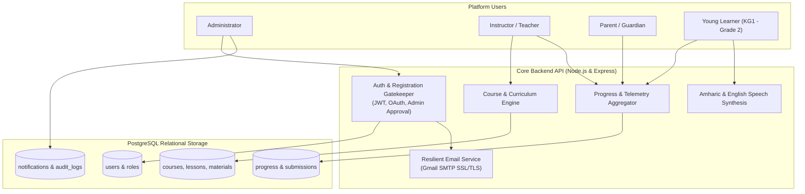

# 🎓 Children Learning Hub (Brana Kids Hub)
## Project Progress Report & Advisor Presentation Guide

**Project Title:** Children Learning Hub (Brana Kids Hub / BranaYouth)  
**Target Audience:** Early Childhood & Primary Education (Kindergarten 1 – Grade 2 & Primary Grades)  
**Core Technologies:** React.js, Tailwind CSS, Node.js (Express), PostgreSQL, Edge/Web Text-to-Speech (TTS), Nodemailer  
**Date:** November 2026  

---

## 📌 Executive Summary

The **Children Learning Hub** is a multi-portal, interactive Educational Management System (EMS) and digital learning platform tailored for young learners, with first-class support for both **Amharic (Ethiopic Fidel)** and **English** bilingual literacy, early **Mathematics**, and foundational **Science & General Knowledge**.

The platform is designed around four specialized user roles:
1. **Child Portal (Learner Experience):** Gamified, multimodal, voice-assisted interactive lessons with ordering, matching, and counting practice.
2. **Instructor Portal:** Dual-mode curriculum authoring (Guided Visual Builder for KG1–G2 with specialized Fidel, Math, and Science studios; Standard Builder for primary grades), submission grading, and real-time student learning matrices.
3. **Parent Portal:** Family profile management, child progress telemetry, and instructor messaging.
4. **Administrator Portal:** Account approval workflow, security verification, role assignments, and audit logging.

---

## 🏗️ System Architecture & Portal Overview

---

## 🚀 Key Modules & Completed Progress

### 1. Child Interactive Learning Experience (`BasicChildLessonExperience`)
* **Multimodal Card Carousel:** Displays high-contrast characters, phonetic guides, child-friendly words, and English/Amharic translations.
* **Audio-First "Say It!" Engine:** Integrates speech synthesis for both Amharic and English; provides voice pronunciation guidance with responsive feedback.
* **Interactive Ordering Activity (`InteractiveOrderingPlayer`):** 
  * Children tap shuffled sequence tiles to place them into numbered targets (`#1`, `#2`, `#3`...).
  * Dynamic validation, celebration banners, and automatic progress saving upon completion.
* **Interactive Matching Activity (`InteractiveMatchingPlayer`):** Shuffled two-column matching with immediate auditory feedback.
* **Progress Tracking:** Automatic status progression from `not_started` $\rightarrow$ `in_progress` $\rightarrow$ `completed`.

---

### 2. Instructor Guided Lesson Studio (`BasicGuidedLessonBuilder`)
* **Unified Fidel Family Card Studio:**
  * Solved the "7-card jerky overflow" problem by grouping all 7 phonetic orders ($\text{ግዕዝ, ካዕብ, ሣልስ, ራብዕ, ኃምስ, ሳድስ, ሳብዕ}$) into **one unified, cohesive card block**.
  * Provides a horizontal quick-switch strip (`[1. ሀ] [2. ሁ] [3. ሂ] [4. ሃ] [5. ሄ] [6. ህ] [7. ሆ]`) and a toggleable 7-form grid view.
  * Inline voice testing directly inside the builder.
* **Multi-Subject Presets (Subject-Adaptive):**
  * **Amharic Studio:** Full 33 Fidel families with example vocabulary.
  * **English Studio:** A–Z Alphabet cards with pictures, phonetic sounds, and translations.
  * **Mathematics Studio:** Numbers 0–20 with dot counting sets (`●●●`), geometric shapes (Circle, Square, Triangle, Star...), and arithmetic operations ($+, -, \times, \div, =$). One-click batch sequence insertion (1–5, 1–10).
  * **Science & General Knowledge Studio:** 10 core colors, 12 animals, 8 human body parts, and everyday nature/fruit items.
  * **Smart Subject Detection:** Automatically highlights the recommended studio based on the active course subject.
* **Interactive Live Child Preview (Step 4):** Allows the instructor to test the child's perspective (visuals, buttons, activities, sound) before publishing.

---

### 3. Student Progress & Learning Matrix Deduplication
* **Telemetry Aggregation:** Instructors track course completion rate, active learners, activities graded, and average quiz scores.
* **Query Deduplication:** Replaced Cartesian multi-table joins with an optimized `LATERAL` subquery (`lesson_id IS NULL LIMIT 1`), ensuring each enrolled student appears **strictly once per assigned course**.

---

### 4. Resilient Security & Administrator Approval Pipeline
* **Account Verification & School Safety Gate:**
  * When instructors or parents register, their email is validated.
  * The account enters the `pending` administrator review queue to guarantee student safety.
* **UX Overhaul for Verified Applicants:**
  * Overhauled `/verify-email` with a dedicated "Pending Administrator Review" status screen, removing confusing verification code prompts when an account is already verified.
* **Resilient SMTP Delivery:**
  * Configured Gmail transport with SSL port 465 fallback to prevent firewall/ISP port 587 timeouts (`ETIMEDOUT`).
  * Dispatches automated approval notifications upon administrator review.

---

## 📊 Summary of What Has Been Delivered

| Feature / Domain | Previous State | Current Delivered State |
| :--- | :--- | :--- |
| **Fidel Lesson Builder** | Added 7 separate, massive cards; jerky scrolling | **1 Unified 7-Form Block** with interactive tabs, grid toggle, and audio preview |
| **Subject Diversity** | Only Amharic & English | **Added Mathematics & Science/GK Studios** (Numbers, Shapes, Colors, Animals, Body Parts) |
| **Child Practice Stages** | Blank white card on Put in Order | **Interactive Ordering & Matching Players** with fallback generators & audio |
| **Instructor Progress Matrix** | Students duplicated 3x due to lesson join | **Clean single-row matrix** using optimized LATERAL query |
| **Registration / Email UX** | Asked for 6-digit code after email was verified | **Dedicated Pending Approval Screen**; automated approval emails via resilient SMTP |

---

## 🎯 Recommended Advisor Presentation Flow

When presenting to your advisor, follow this structured 5-step agenda:

1. **Introduction & Motivation (2 mins):**
   * Emphasize the unique challenge: Bilingual early childhood digital education (Ethiopic Fidel + English + Math) tailored for young non-readers.
2. **Architecture & Role Separation (3 mins):**
   * Explain the 4-tier model (Admin, Instructor, Parent, Child) and data flow.
3. **Live Demonstration (5 mins):**
   * **Instructor Experience:** Open `/instructor/courses/20/lessons/create` $\rightarrow$ show Step 2 with the 4 Subject Studios $\rightarrow$ Insert the **ሀ Family Unified Card** $\rightarrow$ Insert a **Math Number Card** $\rightarrow$ switch to Step 4 (Live Preview).
   * **Child Experience:** Show the interactive card, tap **"Say It!"** to hear pronunciation, and demonstrate the **"Put in Order"** practice game.
   * **Progress Telemetry:** Show the **Student Learning Progress Matrix** with deduplicated real-time statistics.
4. **Technical Innovations Solved (3 mins):**
   * Fidel family unification (reducing DOM nodes and UX clutter).
   * Relational progress matrix optimization.
   * Resilient email delivery and safety review pipeline.
5. **Future Roadmap & Q&A (2 mins):**
   * Voice recognition for speech grading, offline PWA mode, and expanded Grade 3–8 interactive STEM labs.
